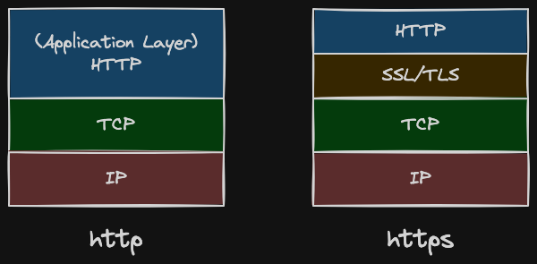
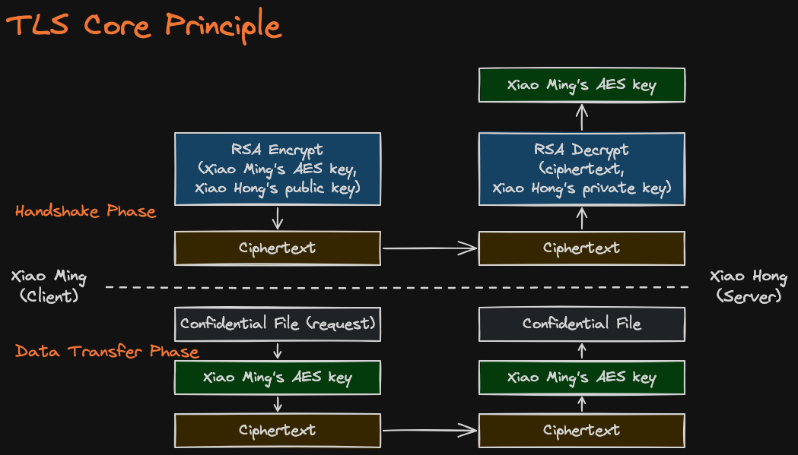
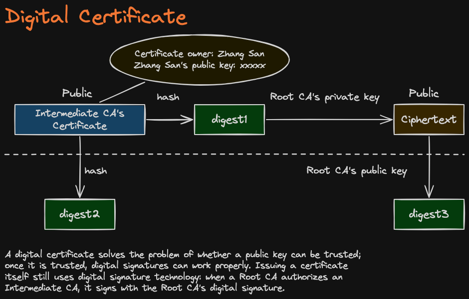

## Grpc

1.  Serialization with protobuffer
2.  Multiplexing - gRPC sends many requests at the same time over one long-lived TCP connection (Good for concurrent scenario)

- With HTTP/1.1, a connection can handle only one request/response at a time.
  If you send request B while request A is still in flight, B waits.
  To get concurrency, clients open several connections, and each new connection pays for: a TCP handshake, a TLS handshake (if using HTTPS)

- With HTTP/2 (one connection, many streams interleaved)

```
conn1: [A1][B1][C1][A2][D1][B2][C2][D2][A3]...
└─ each RPC is a "stream" with its own ID;
its data is split into frames that get mixed together
```

## HTTP


In HTTP Layer, SSL/TLS will encrypt the data and pass to TCP, so communicate is encrypted




**Problem:** To encrypt for Xiao Hong, you need her public key. But an attacker could send you their own key instead. How do you know the key is really hers?

**Solution:** A trusted CA (Certificate Authority) signs a certificate that says "this public key belongs to Xiao Hong."

**Issuing (CA does this):**
1. Hash the certificate content to get **digest1**.
2. Encrypt digest1 with the **CA's private key** to get the **signature**.
3. Attach the signature to the certificate.

**Verifying (you do this):**
1. Hash the certificate content yourself to get **digest2**.
2. Decrypt the signature with the **CA's public key** to get **digest3**.
3. If digest2 == digest3, the certificate is real and unchanged, so you can trust the public key inside.

An attacker can't fake it, because they don't have the CA's private key.

**Why trust the CA?** Root CA certificates are pre-installed in your OS and browser. The Root CA signs Intermediate CAs, and Intermediate CAs sign website certificates. Your browser checks each link up to the Root:

```
Root CA (built into your device)
  └─ Intermediate CA
       └─ Website certificate
```

**In TLS:** the server sends its certificate, your browser verifies it, and then uses the public key inside to safely exchange the AES key.
